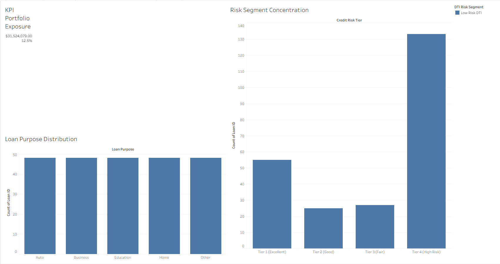

# FinTech Credit Risk & Loan Default Prediction Engine

## Executive Dashboard Preview

## 1. Business Problem
Financial lending institutions face significant exposure to loan defaults, resulting in severe capital loss and diminished portfolio liquidity. Without granular, real-time visibility into borrower risk profiles, debt-to-income thresholds, and historical credit behavior, risk assessment teams struggle to proactively identify high-probability default accounts before delinquency occurs.

## 2. How We Solved It

We engineered a robust, end-to-end data pipeline and risk intelligence engine across our 6-stage architecture:

•	Data Extraction & Staging: Ingested raw loan records via SQL Server Management Studio (SSMS 22) and locked down data integrity within a local Excel vault.

•	Structural Sanitization: Performed rigorous data cleansing to eliminate structural anomalies, trim whitespace, and remove duplicate identifiers.

•	Advanced Feature Engineering: Deployed Python 3.12 (Pandas and NumPy) inside an isolated virtual environment to compute advanced debt-to-income (DTI) risk segmentation and credit risk tiering algorithms, generating a clean production dataset (`final_dashboard_ready.csv`).

•	Executive Visualization: Built an interactive Tableau executive risk dashboard featuring portfolio exposure KPIs, DTI risk concentration bar charts, and loan purpose distribution breakdowns linked via global filters.

## 3. Strategic Recommendations

•	Implement Risk-Based Pricing: Automatically adjust interest rates upward for borrowers entering high-risk debt-to-income brackets to offset potential default loss.

•	Tighten Verification Standards: Institute mandatory income verification workflows for specific loan purposes that exhibit elevated historical default rates.

•	Portfolio Exposure Caps: Limit total capital allocation toward lower credit sub-grades during macroeconomic downturns to protect institutional liquidity.

## 4. Tech Stack & Architecture
•	Database Engine: Microsoft SQL Server Management Studio
•	Storage Vault: Excel
•	Code-First Processing: Python 3.12, Pandas, NumPy, Jupyter Notebooks
•	Visualization: Tableau Desktop (`.twbx`)
•	Version Control: Git & GitHub

